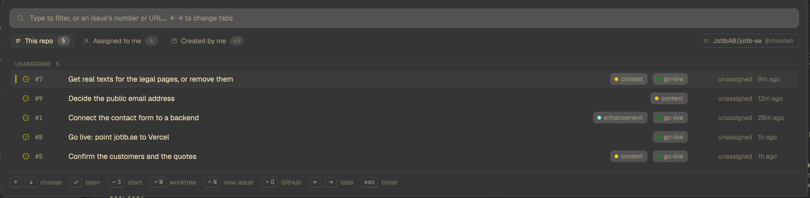

# GitHub Issues for Herdr

A [Herdr](https://herdr.dev) mod that shows your GitHub issues in a popup, with the same look as Herdr's Linear popup. It shows the open issues of the repo in the shown space, the issues that are assigned to you, and the issues that you created. Open an issue to see its labels, its linked pull requests, its body and its comments. From the popup, you can close or reopen an issue, assign it to yourself, or file a new issue. One key makes a worktree for the issue and starts a coding agent on it.

`RECIPE.md` tells how the mod looks and operates, and how to build it from the start.

## Install

With the Herdr CLI (macOS and Linux):

1. Run `herdr plugin install shoobah/herdr-issues`.
2. Sign in to the GitHub CLI with `gh auth login`.
3. In the Herdr app, push ⌘I.

The install copies `mods/issues/` into `~/.config/herdr-app/mods/` (or `$HERDR_APP_HOME/mods/`). It also adds the keys of `keys.json` to the `keys.json` of the app. If ⌘I is already bound, the install does not change it. Then bind `mod.open:issues` to a different key yourself. `herdr plugin update` installs the new version of the mod and replaces the files in `mods/issues/`.

The repo is a mod for the Herdr desktop app, not a TUI plugin. `herdr-plugin.toml` only lists it on the [Herdr marketplace](https://herdr.dev/plugins/) and runs `scripts/install-app-mod.sh`. It adds no actions or panes to the TUI.

By hand:

1. Copy `mods/issues/` into `~/.config/herdr-app/mods/`.
2. Merge `keys.json` into `~/.config/herdr-app/keys.json`. It binds ⌘I to open the popup.
3. Sign in to the GitHub CLI with `gh auth login`.
4. Run `herdr-app check ~/.config/herdr-app/mods/issues`.

The mod runs `gh` on this computer for all calls to GitHub. It runs `git` to find the repo of each space and to make worktrees. It writes `issues-cache.json` in the Herdr home folder.

## Credits

`mods/issues/look.js` and most of the icons in `mods/issues/icons/` come from the `linear` mod that ships with Herdr. They give this popup the same look as Herdr's Linear popup. They belong to the authors of Herdr, and the MIT license in `LICENSE` does not cover them. The icons `issue-open.svg`, `issue-done.svg`, `issue-skip.svg` and `comment.svg`, and the remaining code, are under the MIT license in `LICENSE`.
