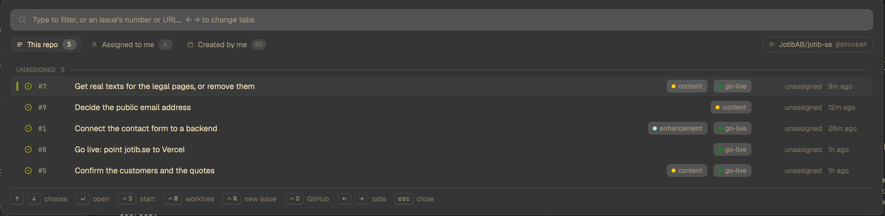

# Issues

A popup that shows your GitHub issues, in the same style as Herdr's Linear popup. ⌘I opens it. It shows three lists: the open issues of the repo in the shown space, the open issues that are yours, and the issues that you created. Open an issue to see its state, assignees, labels, milestone, linked pull requests, body and comments. From the popup, you can close, reopen or assign an issue, and file a new issue.

One key makes a worktree for an issue and starts a coding agent in it.

## What you see

The popup is a Herdr overlay: `kind: "popup"`, at the top, 40px down, 80% of the window wide and high. The background is `theme().popover`, with 16px padding, a 10px gap between rows and 13px text.

Colour shows state only. All surfaces use the neutral colours of the theme. The state colours are: open `ansi2`, closed as completed `ansi5`, and closed as not planned `dim`. A label has its own GitHub colour.

**List screen**, from top to bottom:

1. **Filter field.** 36px high, 9px radius, `input` background, 1px `border` line, and a 15px search icon on the left. The placeholder is "Type to filter, or an issue's number or URL…  ← → to change tabs".
2. **Tab bar.** Three tabs, each 28px high with a 7px radius: **This repo** (project icon), **Assigned to me** (person icon) and **Created by me** (calendar icon). Each tab has an 18px count pill that shows "–" until the count is known. The selected tab has a `raised` background, a small shadow and semibold text. While a tab loads, a spinner replaces the icon of the tab.

   Below 700px width, the labels become "Repo", "Mine" and "Created". At the right end is a 26px chip with a 1px border: the repo of the shown space (`owner/name`, or "No repo here") and your GitHub login in mono.
3. **Issue list.** Rows are 34px in 36px slots, in a virtual list that is a maximum of 560px high, with a scrollbar. A 30px heading (the group name in upper case, the count, and a 1px line) starts each group. The groups are:
   - **This repo**: "Assigned to you", "Unassigned", then "Assigned to others".
   - **Assigned to me**: one group for each repo. The repo of the shown space is first.
   - **Created by me**: "Open", then "Closed".

   A row shows, from left to right:
   - A 3px × 16px bar in the state colour, only on the selected row.
   - The state icon, 14px: a ring with a dot (open), a ring with a check (completed), or a ring with a line through it (not planned).
   - The number, `#12`, 11.5px JetBrains Mono in `muted`, 52px wide.
   - The title, 13.5px in `foreground` (medium weight when selected). The title truncates.
   - At 760px and wider, a maximum of two label chips: a 7px dot in the label colour and the label name.
   - "agent" or "2 agents", if agents work on the issue (refer to How it operates).
   - A worktree icon in `accent`, if the issue has a worktree.
   - At 760px and wider, on **Created by me** only, the repo (150px).
   - The assignee (110px, 80px below 700px): "you", the first login, or "unassigned".
   - At 760px and wider, how long ago the issue changed (64px).

   The selected row has a `raised` background and a small shadow. Other rows get the same background on hover.
4. **Note line** (when there is a note). A busy message in `accent` with a spinner, an error in `ansi1`, or a confirmation in `muted`.
5. **Footer.** A 1px top line, then keys as keycaps (20px, 5px radius, 2px bottom border, mono 11px), each with the name of its action.

**Issue screen**, from top to bottom:

1. A back button with the tab name. A state chip (icon and word, in the state colour: Open, Closed or Not planned). A click on the chip opens the change menu. Then the number in mono and the repo.
2. The title, 17px semibold.
3. Fields, each with a 72px label in `dim` and a value:
   - **Assignees**: each login with a person icon, and "(you)" after your login. Else "unassigned".
   - **Opened**: "3d ago by ⟨author⟩".
   - **Labels**: the label chips.
   - **Milestone**: a chip, if the issue has a milestone.
   - **Pull requests**: the pull requests that close the issue, as `accent` chips (`#14` and the first 48 characters of the title). A click opens the pull request.
   - **Branch**: the branch name as a mono chip (a click copies it), then a "worktree" chip in `accent`, or "no worktree yet".
4. A start banner with a 10% `accent` tint, when the issue is open, is yours or has no assignee, and has no agents: "Start: yours, a worktree, and an agent in it working on it", with an accent **Start** button. When agents work on the issue, an **AGENTS n** list shows them (a maximum of 4 rows of 28px).
5. A 1px line with the comment count on its right. Then a 360px scroll area with one markdown view: the body ("*No description.*" when it is empty), then each comment after a rule, under a line with the author and how long ago.

**Change menu** (the **c** key). A card with a 10px radius, a `raised` background and a medium shadow, titled "⟨owner/name⟩#⟨number⟩". Its items are 30px rows with a number from 1:

- On an open issue: **Close as completed** and **Close as not planned**.
- On a closed issue: **Reopen**.
- **Assign to me**, or **Unassign me** when the issue is yours.

**New issue screen** (the **n** key), from top to bottom:

1. The title "New issue in ⟨owner/name⟩".
2. A title field and a description field (36px, `input` background).
3. **Labels**: the labels of the repo as chips that you can select (one or more).
4. **Assignee**: Me or Nobody.
5. A **File issue** button in `accent`.

**Sign-in screen.** Herdr shows it when `gh` is not signed in. It has the title "Sign in to GitHub", a paragraph about `gh auth login`, an accent **Sign in** button, and a "Try again" link.

## How it operates

- **The repo.** The repo of the shown space is the `origin` remote of the folder of its first terminal (else the folder of the space). Only GitHub remotes count.
- **Agent status.** The agents of an issue are the agents in panes on the branch of the issue. On a row: if one of them has the status `working`, a spinner and "agent" in the `working` colour. Else a person icon and "agent" in `dim`. On the issue screen, each agent has an icon for its status:
  - `working`: a spinner in the `working` colour.
  - `blocked`: the need icon in the `blocked` colour.
  - `done` or `idle`: the idle icon in `dim`. A click on an agent closes the popup and runs `agent.focus`.
- **List keys.** ↑ ↓ select a row (page up and page down move 12 rows). Enter opens the issue. A click selects a row, and a second click opens it. ← → change tabs while the filter is empty. ⌃S starts the issue, ⌃W opens its worktree, ⌃N files a new issue, and ⌃O opens the issue on GitHub. Esc closes the popup.
- **Filter.** Each word must match the number (`#12`), title, repo, author, milestone, an assignee, a label, or "open" or "closed". If the text is `12`, `#12`, `owner/name#12` or an issue URL, the mod finds that issue on GitHub 300ms after you stop. If the issue is not in the tab, it shows under the heading "Not in this list". A number alone uses the repo of the shown space.
- **Issue keys.** **w** opens the worktree. **s** starts the issue. **c** opens the change menu. **n** files a new issue. **o** opens the issue on GitHub. **y** copies `owner/name#12`. **b** copies the branch name. **g** opens the pull request (a menu when there are more than one). **r** loads the issue again. ← or backspace goes back. In the menu: ↑ ↓, enter, or 1–9.
- **Changes.** Each change runs from the menu only, not from one key. The note line shows "Closing #12…", then "Closed #12.", "Closed #12 as not planned.", "Reopened #12.", "#12 is yours." or "You're off #12.". After each change, the mod loads the issue and the lists again.
- **Branch.** The branch of an issue is `⟨number⟩-⟨title⟩`, as `gh issue develop` names it: the title in lower case, words joined by hyphens, a maximum of 40 characters, cut between words. When the mod made a worktree for the issue before, it uses the branch of that worktree.
- **Worktree.** The checkout is the main checkout of a space with the repo of the issue, on the machine of that space. If a worktree has the branch already, the mod uses it.
  Else the mod fetches `origin` and adds a worktree in `⟨worktrees.directory⟩/⟨repo folder⟩/⟨branch⟩`. The default directory is `~/.herdr/worktrees`, as for Herdr's `worktree` mod. The start point is the local branch, else `origin/⟨branch⟩`, else `origin/HEAD` with `--no-track`, else `HEAD`.
- **Worktree space.** If a space shows the worktree, the mod selects that space. Else it opens a new unnamed space in the worktree, so the space nests under its repo.
- **Start.** Only for an open issue that is yours or has no assignee. The mod assigns the issue to you, makes the worktree, and opens its space with Claude Code (else the first installed agent). The first message of the agent gives the repo, number, title and URL. It tells the agent to read the issue with `gh issue view ⟨n⟩ --repo ⟨repo⟩ --comments`, to do the work test-first, and to commit with `Closes #⟨n⟩`. If a space shows the worktree already, the mod sends no message, because its agent can be busy.
- **New issue.** The repo is the repo of the open issue, else the repo of the shown space. **File issue** runs `gh issue create` and then opens the new issue.
- **Pull request.** If Herdr's `github` mod is installed, **g** opens the pull request there with `backTo`. Esc in the GitHub popup comes back to this issue. Without the GitHub mod, **g** opens the pull request in the browser.
- **Refresh.** All three tabs load when the popup opens, and again each minute while the list shows. Each change loads them again too. The lists are kept in `~/.config/herdr-app/issues-cache.json`, so the popup shows the last lists immediately.

## Built from

- `mods/issues/mod.json`: `{ "place": "none", "title": "Issues", "overlay": { "kind": "popup", "at": "top", "offset": 40, "width": 0.8, "height": 0.8 } }`.
- `mods/issues/main.js`: one `View`, with the screens `list`, `issue` and `create`, plus a menu and a sign-in state. The keyboard goes to the filter input on the list screen, and to a `focus_handle` on the issue screen. `nextCommand()` takes `escape`, `tab`, `backtab`, `next`, `prev` and `reload`. Props: `issue: { repo, number }` opens that issue directly, and `backTo` is where the back button goes then.
- `mods/issues/look.js`: `tones`, `tint`, `chip`, `key` and `cap` (keycaps), `countPill`, `ago`, `icon`, `hue` and `issueLook`. A copy of the look of Herdr's shipped `linear` mod, so the popups match.
- `mods/issues/icons/`: the icons of Herdr's `linear` mod, and `issue-open`, `issue-done`, `issue-skip` and `comment`. `svg()` tints them.
- `keys.json`: `"cmd-i": "mod.open:issues"` in `global`, and `"mod:issues"` with `escape`, `tab` and `shift-tab`.
- `herdr` functions: `exec`, `spaces`, `panes`, `agents`, `knownAgents`, `run`, `theme`, `props`, `appHome`, `readTextFile`, `checking`, `openOverlay`, `closeOverlay` and `nextCommand`. Commands: `space.new` (sign-in and worktrees), `space.select` and `agent.focus`.
- **GitHub CLI** (`gh`, through `exec`, on this computer):
  - `gh api user --jq .login`: who you are, and whether `gh` is signed in.
  - `gh issue list --repo R --state open --limit 200 --json …,milestone`: the **This repo** tab.
  - `gh search issues --assignee @me --state open --limit 100 --sort updated`: the **Assigned to me** tab.
  - `gh search issues --author @me --limit 60 --sort updated`: the **Created by me** tab.
  - `gh issue view N --repo R --json …,body,stateReason,comments,closedByPullRequestsReferences`: one issue.
  - `gh issue close N --reason "completed" | "not planned"`, `gh issue reopen N`, and `gh issue edit N --add-assignee @me | --remove-assignee @me`: the changes.
  - `gh label list --repo R --json name,color` and `gh issue create --repo R --title … --body … --label … --assignee @me`: a new issue.
- **git** (through `exec`, on the machine of the space): `remote get-url origin` and `rev-parse --git-common-dir` find the repo and main checkout of each space. `worktree list --porcelain`, `fetch origin`, `rev-parse --verify` and `worktree add` make a worktree.

## Watch out

- **Programs, network and files.** The mod runs `gh` and `git`, and `sh` to find `$HOME` on a machine. It reaches GitHub only through `gh`. It reads `settings.json` in the Herdr home folder for `worktrees.directory`. It writes `issues-cache.json` in the Herdr home folder.
- **`gh` can be absent from the PATH of Herdr.** If `exec("gh")` cannot start, the mod runs `gh` in a login shell: `sh -lc 'exec gh "$@"'`.
- **`exec` has a 30-second limit.** `git fetch` gets 120 seconds and `git worktree add` gets 10 minutes, each with its own `timeout`.
- **Search and list give different shapes.** `gh search issues` gives `state` in lower case and a `repository` object. `gh issue list` gives `state` in upper case and no repo. `norm()` makes them the same. Search results do not include `stateReason`, so a closed issue in **Created by me** shows as completed until you open it.
- **Label colours** come without `#` from `gh`. The mod adds it.
- **Agents match by branch name.** An agent counts for an issue only if its pane is on the branch of the issue. If you work on the issue on a branch with a different name, the mod does not find the agents.
- **Worktrees need a space with the repo.** An issue from a repo that no space has a checkout of cannot get a worktree. The note line tells you to open a checkout first.
- **One page only.** The tabs show a maximum of 200, 100 and 60 issues. The mod does not get more pages.
- **Nothing that changes GitHub runs on one key.** Close, reopen and assign go through the menu. Start assigns the issue to you only after the checks.
- **`checking()`.** During `herdr-app check`, `init()` stops before it calls `gh` or `git`.

## Done when

- `herdr-app check ~/.config/herdr-app/mods/issues` passes.
- With `gh` signed in, ⌘I opens the popup on the list. The three tabs get counts, and the chip shows the repo of the shown space and your login.
- In a space without a GitHub checkout, **This repo** says "The shown space isn't a checkout of a GitHub repo.", and the other tabs load.
- The text `owner/name#12`, for an issue that is not in the tab, shows that issue under "Not in this list". Enter opens its screen with its labels, body and comments.
- **c** on an open issue shows "Close as completed", "Close as not planned" and "Assign to me". After "Assign to me", the issue moves to "Assigned to you" in **This repo**.
- **s** on an issue without an assignee assigns it to you. It makes a worktree on `⟨number⟩-⟨title⟩`, and opens a space with Claude Code and the prompt. When you open the issue again, AGENTS shows the agent, with a spinner while the agent works.
- **n** files an issue with the selected labels and opens it.
- **g** on an issue with a linked pull request opens the pull request in the GitHub mod, and Esc there comes back to the issue.
- Without a `gh` sign-in, the popup shows the sign-in screen, and **Sign in** opens a space that runs `gh auth login --web`.
- Esc closes the menu, then the issue screen, then the popup.
